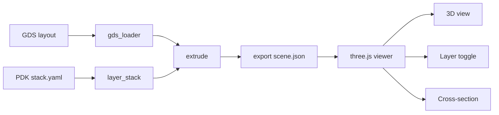

# OpenProcess3D

Free, open-source 3D semiconductor process visualizer for students.
See how a chip is built layer by layer, in your browser, with no license
and no install.

> **Status: Phase 0 (early).** The GDS loader works. The 3D viewer is in
> progress. Nothing here is a finished tool yet.

<!-- TODO: add GIF of the inverter rotating and being sliced once v0.1 renders -->

## Why

Commercial process simulators are paid and locked to industry. Students
get almost nothing comparable. This project aims to be a free learning
tool that grows as process technology advances.

This is an educational visualizer, not a calibrated TCAD tool, and it is
not affiliated with any commercial product.

## What works today

- [x] Load a GDS layout into polygons per (layer, datatype), with
      hierarchy flattening
- [x] Unit tests and CI (pytest on every PR)

## Roadmap

- [ ] Phase 1: layer stack (YAML) -> extrude -> `scene.json` -> three.js
      viewer with layer toggle and cross-section
- [ ] Phase 2: process step plugins (deposit, etch, CMP, implant) and a
      recipe file format
- [ ] Phase 3: docs, tutorials, public release `v1.0`
- [ ] Later: advanced nodes and physics-based models

## Architecture



## Quick start

```bash
python -m venv .venv
.venv\Scripts\activate        # Windows (Linux/macOS: source .venv/bin/activate)
pip install -e ".[dev]"
pytest
python -m core.layout.gds_loader path/to/layout.gds
```

## Repo layout

```
core/      Python engine (loader, stack, extrude, export)
pdks/      Open PDK stack definitions (sources cited per number)
viewer/    three.js web viewer (planned)
examples/  Sample layouts
docs/      Architecture and format docs
tests/     pytest suite
```

## Data policy

Only open PDKs (SKY130, GF180) and published papers are used. No NDA data
and no assets from commercial tools. Any estimated value is flagged
`approx: true` with its source.

## Contributing

Work happens on branches and lands in `main` through reviewed PRs with
passing CI. Good first issues will be labeled once Phase 1 issues are
filed.

## License

Apache-2.0