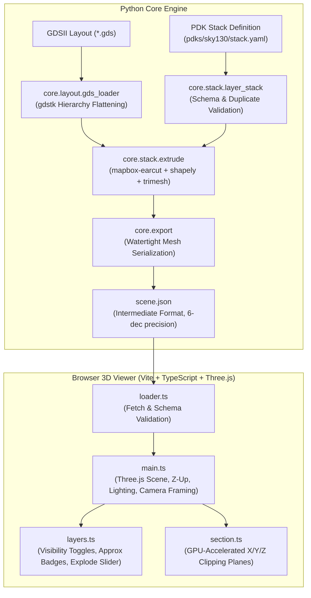

# OpenProcess3D

[](https://opensource.org/licenses/Apache-2.0)
[](https://www.python.org/)
[](https://www.typescriptlang.org/)
[](https://threejs.org/)
[](https://github.com/harikrishnanm5/VLSI4Everyon/actions/workflows/ci.yml)
[](https://github.com/google/skywater-pdk)

**OpenProcess3D** is a free, open-source 3D semiconductor process visualizer designed for students, educators, and VLSI engineers. It bridges the gap between 2D IC mask layouts (GDSII) and physical 3D silicon structures directly in the browser—with zero proprietary software licenses, zero installation friction, and full interactive control.

---

## Why OpenProcess3D?

In commercial semiconductor manufacturing, 3D TCAD and process emulation tools (such as SEMulator3D®) cost tens of thousands of dollars and are strictly gated behind enterprise non-disclosure agreements. Students and university researchers rarely get to inspect what their planar layouts actually look like once fabricated in silicon.

OpenProcess3D provides:
- **Transparent Open-Source Process Modeling:** Built around open-source PDKs like SkyWater SKY130 and GlobalFoundries GF180MCU.
- **Physical Insight:** Understand how planar lithography masks translate into complex multi-layer interconnects, vias, and gate structures.
- **Pure WebGL 3D Visualization:** Fast, client-side Three.js rendering with GPU-accelerated cross-sectioning and layer explosion controls.

> **Status (Phase 1 Complete):** Full end-to-end pipeline operational: GDS layout + PDK stack YAML $\rightarrow$ 3D mesh extrusion $\rightarrow$ `scene.json` $\rightarrow$ Three.js viewer with layer visibility toggles, stack explode slider, and dynamic $X/Y/Z$ cross-section clipping.

---

## Key Features

- **High-Performance GDSII Ingestion:** Fast layout parsing with cell reference flattening and repetition resolution powered by `gdstk`.
- **Declarative PDK Layer Stacks:** YAML-based process stack definitions specifying layer elevation ($z$), film thickness ($t$), material attributes, and explicit approximation tracking (`approx: true`).
- **Watertight 3D Geometry Extrusion:** 2D-to-3D ear-clipping polygon triangulation (`mapbox-earcut` + `shapely` + `trimesh`) supporting concave boundaries and interior holes with watertight manifold mesh guarantees.
- **Interchange Scene Format (`scene.json`):** Compact, versioned intermediate JSON schema packaging layer geometries, bounds, and process metadata with micro-meter precision coordinates rounded to 6 decimal places.
- **Three.js Web Viewer:**
  - **Semiconductor CAD Orientation:** Native $Z$-axis up vertical coordinates with automatic camera framing to layout bounding boxes.
  - **Stack Explode Slider:** Vertically separate layers along $z$ by $\text{index} \times \text{factor}$ to inspect buried contacts, gates, and interconnect interfaces without altering base geometry.
  - **Dynamic Cross-Section Slicing:** Real-time GPU clipping planes along $X$, $Y$, or $Z$ axes with interactive coordinate scrubbing and cut-side flipping.
  - **Layer Inspection Panel:** Color-coded layer swatches, material identifiers, visibility checkboxes, and PDK approximation badges.

---

## System Architecture



---

## Quickstart Guide

### 1. Prerequisites

- **Python 3.9+**
- **Node.js 20+** and **npm**

### 2. Clone and Setup Environment

```bash
git clone https://github.com/harikrishnanm5/VLSI4Everyon.git
cd VLSI4Everyon

# Setup Python virtual environment
python -m venv .venv
# Windows:
.venv\Scripts\activate
# Linux/macOS:
# source .venv/bin/activate

# Install Python package in editable mode with development dependencies
pip install -e ".[dev]"
```

### 3. Generate 3D Scene from GDS

Use the end-to-end export CLI to process a layout against a PDK layer stack:

```bash
# Export test layout to scene.json
python -m core.export examples/test.gds pdks/sky130/stack.yaml viewer/public/scene.json
```

To inspect raw layer counts of any GDSII file:
```bash
python -m core.layout.gds_loader examples/test.gds
```

### 4. Launch the Interactive 3D Viewer

```bash
cd viewer
npm install
npm run dev
```

Open your browser at `http://localhost:5173/` (or specify a custom scene with `http://localhost:5173/?scene=/scene.json`).

---

## Running the Test Suite

Both the Python core and the TypeScript frontend maintain test suites with 100% pass rates in automated CI:

### Python Unit Tests (pytest)
```bash
pytest -v
```
*(36 tests covering GDS parsing, stack validation, polygon ear-clipping, concave/multi-hole watertight extrusions, scene export, and CLI pipelines)*

### TypeScript & Viewer Tests (vitest)
```bash
cd viewer
npm test
```
*(19 tests covering explode offset formulas, clipping plane vectors, and coordinate projection math)*

### Production Viewer Build
```bash
cd viewer
npm run build
```

---

## Repository Structure

```text
├── core/
│   ├── layout/
│   │   └── gds_loader.py       # GDSII parsing & hierarchy resolution (gdstk)
│   ├── stack/
│   │   ├── layer_stack.py      # PDK YAML loader & validation dataclasses
│   │   └── extrude.py          # 2D-to-3D polygon triangulation & extrusion
│   └── export.py               # Scene serialization & CLI pipeline
├── pdks/
│   └── sky130/
│       └── stack.yaml          # SkyWater 130nm layer definitions
├── viewer/
│   ├── src/
│   │   ├── loader.ts           # Schema validation & BufferGeometry construction
│   │   ├── main.ts             # Three.js CAD scene, Z-up camera, lighting
│   │   ├── layers.ts           # Layer visibility list & stack explode controller
│   │   ├── section.ts          # X/Y/Z clipping plane cross-section engine
│   │   ├── layers.test.ts      # Unit tests for layer logic
│   │   └── section.test.ts     # Unit tests for clipping plane calculations
│   ├── public/
│   │   └── scene.json          # Pre-packaged sample layout scene
│   ├── index.html              # Clean dark-themed CAD viewport UI
│   ├── package.json            # Vite, Three.js, Vitest, TypeScript dependencies
│   └── tsconfig.json           # Strict TypeScript configuration
├── examples/
│   ├── test.gds                # Sample GDSII inverter layout
│   └── scene.json              # Reference exported scene
├── tests/
│   ├── test_gds_loader.py      # GDS loading & hierarchy tests
│   ├── test_layer_stack.py     # YAML schema & validation tests
│   ├── test_extrude.py         # Manifold mesh & geometry tests
│   └── test_export.py          # scene.json schema & CLI tests
└── .github/workflows/
    └── ci.yml                  # Automated Python + Node.js CI workflow
```

---

## Intermediate Scene Format (`scene.json`)

`scene.json` is a lightweight, human-readable intermediate format connecting CAD layout generators to web visualizers:

```json
{
  "version": 1,
  "units": "um",
  "layers": [
    {
      "name": "poly",
      "material": "polysilicon",
      "z": 0.0,
      "thickness": 0.2,
      "approx": true,
      "vertices": [
        [0.0, 0.0, 0.0],
        [10.0, 0.0, 0.0],
        [10.0, 20.0, 0.0]
      ],
      "faces": [
        [0, 1, 2]
      ]
    }
  ],
  "bounds": {
    "min": [0.0, 0.0, 0.0],
    "max": [15.0, 20.0, 1.35]
  }
}
```

---

## Roadmap

- [x] **Phase 0: Layout Ingestion & Skeleton**
  - [x] GDSII loader with polygon extraction and hierarchy flattening.
  - [x] Repository skeleton, type annotations, and CI test runner.
- [x] **Phase 1: 3D Extrusion & Interactive Web Viewer**
  - [x] PDK layer stack specification (`stack.yaml`) with approximation flags.
  - [x] Robust 2D-to-3D polygon triangulation and watertight extrusion.
  - [x] `scene.json` exporter and CLI toolchain.
  - [x] Three.js web viewer with $Z$-up camera framing, OrbitControls, and distinct layer palettes.
  - [x] Layer visibility panel, approximate badges, and vertical explode slider.
  - [x] Dynamic $X/Y/Z$ cross-section clipping planes.
- [ ] **Phase 2: Process Step Engine & Recipes**
  - [ ] Declarative recipe file format (`recipe.yaml`).
  - [ ] Emulated process step plugins: conformal/directional deposition, anisotropic etching, and CMP planarization.
  - [ ] Boolean constructive solid geometry (CSG) operations between silicon and dielectric domains.
- [ ] **Phase 3: Advanced Nodes & Community Ecosystem**
  - [ ] GlobalFoundries 180nm (`GF180MCU`) stack definitions.
  - [ ] Standard-cell library demonstration gallery (inverter, NAND, DFF, SRAM bitcell).
  - [ ] glTF / USDZ export for CAD and AR/VR inspection.

---

## Data Policy & Open Hardware Ethics

OpenProcess3D operates under strict open-source and open-hardware policies:
- **No NDA Data:** We exclusively support open-source PDKs (SkyWater 130nm, GlobalFoundries 180nm) and publicly available academic literature.
- **No Commercial Asset Copying:** Zero code, assets, or proprietary models are copied from commercial TCAD tools.
- **Strict Approximation Transparency:** Any layer thickness, vertical offset, or refractive index derived from estimates rather than foundry-published specs is explicitly flagged with `approx: true`.

---

## Contributing

Contributions from the open-source silicon community, VLSI students, and web graphics developers are warmly welcomed!

1. Fork the repository and create your feature branch from `main`:
   ```bash
   git checkout -b feat/your-feature-name
   ```
2. Commit small, logical changes following [Conventional Commits](https://www.conventionalcommits.org/):
   ```bash
   git commit -m "feat(scope): concise description"
   ```
3. Ensure all tests and builds pass before submitting a pull request:
   ```bash
   pytest
   cd viewer && npm test && npm run build
   ```
4. Open a Pull Request detailing what was changed, how to run, and what to verify.

---

## License

Distributed under the **Apache License 2.0**. See [`LICENSE`](LICENSE) for details.